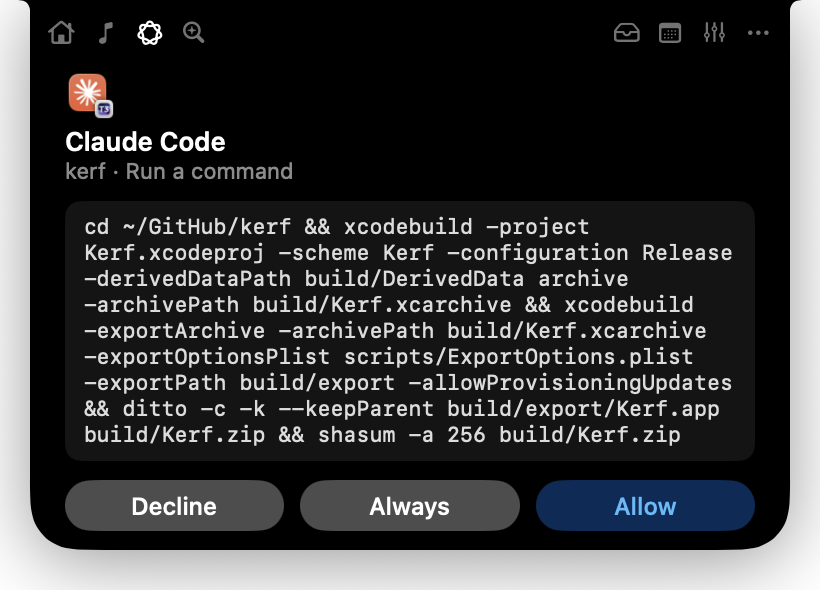
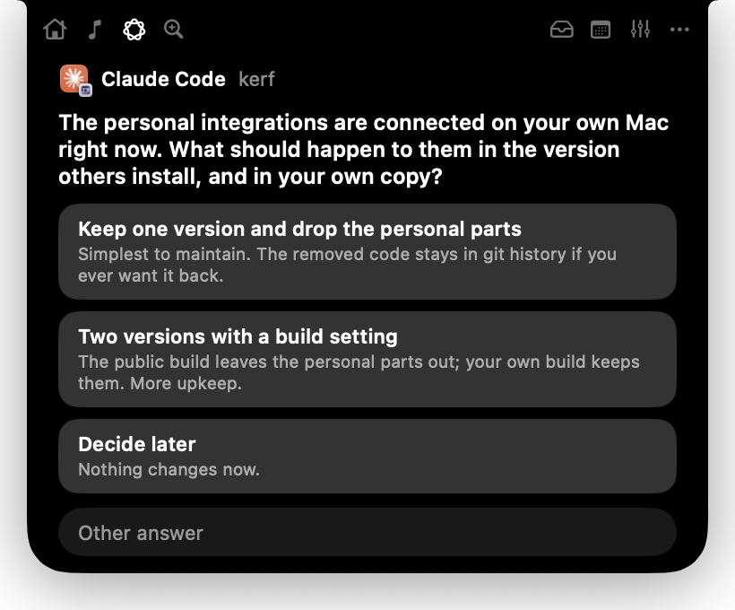

# Kerf (agentic fork)

A Dynamic Island for the MacBook notch, for agentic coding. Your Claude Code sessions live in the
notch: what runs, what's done, and what waits for you.

A fork of [paultje1900/kerf](https://github.com/paultje1900/kerf), narrowed down to coding agents.
See [FEATURES.md](FEATURES.md) for what this fork keeps and what it left out.

<p>
  
  
</p>

- **Permissions**: Allow, Always or Deny a tool call from the notch. You can still answer in the terminal; whichever comes first wins.
- **Questions**: Claude's multiple-choice questions (AskUserQuestion) as buttons, with a field for another answer.
- **Threads**: every Claude Code session, working, waiting or done, with its project. A click opens the app it runs in.
- **Done notices**: a tick in the notch when a session finishes, until you look.
- **Pull requests**: your open PRs under the threads, through `gh`.
- **Ask**: ⌥ Space. A question goes to Claude through your own Claude Code, a few words to Google.
- **Copilot** works too, and any script can use `kerf notify`.

## Install

No admin rights or Apple developer account needed. With Xcode 27 installed:

```bash
scripts/install.sh
```

It builds a Release copy, puts it in `~/Applications` and starts it. Kerf opens at login from there.
macOS 26 (Tahoe) on a Mac with a notch.

## First steps

1. **Settings → Agents → Connect** Claude Code (and Copilot if you use it). Kerf shows the exact change to `~/.claude/settings.json` first and keeps a backup.
2. **Settings → General → Accessibility** (optional): lets Escape close the island from any app.
3. **Pull requests** need the [GitHub CLI](https://cli.github.com), signed in with `gh auth login`.

To remove Kerf, press Disconnect in Settings → Agents first, then delete `~/Applications/Kerf.app`.

## The `kerf` command

```bash
K="$HOME/Library/Application Support/Kerf/bin/kerf"
"$K" notify --agent Build "Tests pass"            # a short message in the notch
"$K" notify --ask --title Deploy "Push to main?"   # waits: exit 0 allowed, 1 declined, 2 no answer
"$K" debug                                         # what the running app sees
```

## Privacy

Kerf has no server and no account. Everything stays on your Mac, except what you ask Claude (through
your own Claude Code), your pull requests (through your own `gh`), and a search, which opens Google in
your browser.

## Build from source

```bash
xcodebuild -project Kerf.xcodeproj -scheme Kerf -configuration Debug -derivedDataPath build/DerivedData build
cd KerfKit && swift test
```

macOS 26, Xcode 27, Swift 6. `Kerf --lab shot <scene> <file.png>` saves a frame of any state without
real data (scenes in `Kerf/Island/Lab.swift`).

## License

MIT, like upstream. Original work © 2026 Paul Boerma.
